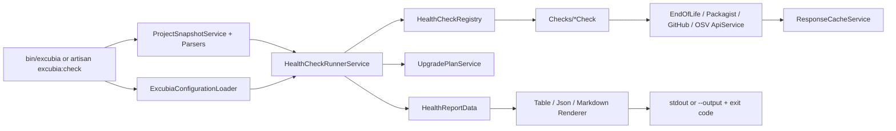

# qiick Excubia — Architecture v0.1.0

Composer package: `qiick/excubia-core`. Install with `composer require --dev qiick/excubia-core`. The CLI binary stays `bin/excubia`.

> Companion to `docs/SPEC.md`. Follows "Codice Perfetto" (`knowledge/conventions/code-quality.md`): `declare(strict_types=1)` everywhere, explicit role suffixes, readonly `*Data` value objects, full English docblocks (why + array shapes + side effects + `@throws`), no abbreviations, boolean `is/has/can/should` prefixes, curly braces and blank lines around control flow, strict DRY. There are no Eloquent models in this package, so every class has a role suffix.

## 1. Layout

```
qiick-io/excubia-core
├── bin/excubia                         # standalone CLI entry (symfony/console), no Laravel boot
├── src/
│   ├── Checks/                         # one class per check, implements HealthCheckContract
│   │   ├── PhpEndOfLifeCheck.php           (php-eol)
│   │   ├── LaravelEndOfLifeCheck.php       (laravel-eol)
│   │   ├── NodeEndOfLifeCheck.php          (node-eol)
│   │   ├── ComposerAdvisoriesCheck.php     (composer-advisories)
│   │   ├── NpmAdvisoriesCheck.php          (npm-advisories)
│   │   ├── ComposerAbandonedCheck.php      (composer-abandoned)
│   │   ├── ComposerStaleCheck.php          (composer-stale)
│   │   └── LaravelNextMajorBlockerCheck.php (laravel-next-blocker)
│   ├── Contracts/
│   │   ├── HealthCheckContract.php          # id(), name(), run(ProjectSnapshotData): CheckResultData
│   │   ├── ReportRendererContract.php       # render(HealthReportData): string
│   │   └── HttpClientContract.php           # getJson(), postJson() — faked in tests
│   ├── Registries/
│   │   └── HealthCheckRegistry.php          # ordered list of checks, --only/--skip filtering
│   ├── Services/
│   │   ├── HealthCheckRunnerService.php     # runs checks, applies ignores, builds report
│   │   ├── UpgradePlanService.php           # derives upgrade-plan from findings
│   │   ├── ProjectSnapshotService.php       # reads + parses manifests into ProjectSnapshotData
│   │   ├── EndOfLifeApiService.php          # endoflife.date client
│   │   ├── PackagistApiService.php          # metadata + security advisories
│   │   ├── GitHubRepositoryApiService.php   # archived flag, last push
│   │   ├── OsvApiService.php                # OSV.dev batch query
│   │   └── ResponseCacheService.php         # file cache with TTL, offline mode
│   ├── Parsers/
│   │   ├── ComposerLockParser.php
│   │   ├── ComposerJsonParser.php
│   │   ├── PackageLockParser.php
│   │   └── NodeVersionParser.php            # .nvmrc / .node-version / engines
│   ├── Renderers/
│   │   ├── TableReportRenderer.php
│   │   ├── JsonReportRenderer.php
│   │   └── MarkdownReportRenderer.php
│   ├── Data/                                # readonly classes
│   │   ├── ProjectSnapshotData.php
│   │   ├── LockedPackageData.php
│   │   ├── CheckResultData.php
│   │   ├── FindingData.php
│   │   ├── HealthReportData.php
│   │   ├── UpgradeStepData.php
│   │   └── ExcubiaConfigurationData.php
│   ├── Enums/
│   │   ├── SeverityEnum.php                 # critical..info, comparable
│   │   ├── FindingStatusEnum.php            # pass|warn|fail|skipped
│   │   ├── ReportFormatEnum.php
│   │   └── ExitCodeEnum.php                 # 0,1,2,3
│   ├── Configuration/
│   │   └── ExcubiaConfigurationLoader.php   # reads + validates excubia.json  [suffix: Loader — see note]
│   ├── Console/
│   │   ├── CheckCommand.php                 # symfony/console command used by bin/excubia
│   │   └── ClearCacheCommand.php
│   ├── Laravel/
│   │   ├── ExcubiaServiceProvider.php       # auto-discovered; registers the Artisan alias only
│   │   └── ExcubiaCheckCommand.php          # php artisan excubia:check → same runner
│   └── Exceptions/
│       ├── InvalidConfigurationException.php
│       ├── LockfileNotFoundException.php
│       └── DataSourceUnavailableException.php
├── tests/{Unit,Feature,Arch,Fixtures}
├── excubia.schema.json                      # JSON Schema of the config file
├── docs/{SPEC.md,ARCHITECTURE.md,report-schema.json,checks/*.md}
└── .github/workflows/ci.yml                 # calls qiick-io/.github reusable workflow
```

Namespace root: `Qiick\Excubia\` (PSR-4 `src/`), tests `Qiick\Excubia\Tests\`.

Note: `Parsers/*Parser`, `Renderers/*Renderer`, `Registries/*Registry`, `Contracts/*Contract` and `*Loader` are role suffixes not listed in the Codice Perfetto table (which is written for Laravel apps). They are proposed here as explicit package roles and must be enforced by arch tests; Approved (A1): keep these suffixes, documented and enforced by arch tests.

## 2. Flow



## 3. Key contracts

```php
interface HealthCheckContract
{
    /** Stable kebab-case id used in config, --only/--skip and reports (e.g. "php-eol"). */
    public function id(): string;

    public function name(): string;

    /**
     * Inspect the snapshot and return findings. Must never throw for data-source
     * outages: return a skipped result with the reason instead.
     */
    public function run(ProjectSnapshotData $projectSnapshot, ExcubiaConfigurationData $configuration): CheckResultData;
}
```

- Checks are pure apart from calls to `*ApiService` classes, which all go through `HttpClientContract` + `ResponseCacheService`.
- Network calls are batched (Packagist advisories accepts many packages per request; OSV `querybatch`).
- Exit code is computed only from findings with status `fail`/`warn` whose severity ≥ `failOn`, after ignores.

## 4. Dependencies (runtime)

`php ^8.2`, `symfony/console`, `symfony/http-client` (or `guzzlehttp/guzzle`; A2), `composer/semver` (constraint checks). Laravel integration uses only `illuminate/support` + `illuminate/console` as **suggested**, not required. No other runtime deps.

## 5. Testing architecture

- `tests/Arch/NamingArchitectureTest.php`: strict types, suffix per folder, `Data` readonly, no `dd`/`dump`/`var_dump`/`env()`, `Checks` only depend on `Contracts`, `Data`, `Enums`, `Services`.
- Each check: one test file with fixtures for pass / warn / fail / skipped.
- Golden-file tests for renderers (`tests/Fixtures/Reports/*.txt|json|md`).
- Fake `HttpClientContract` returning recorded responses; a test asserts no real HTTP happens.

## 6. CI / fleet

- `qiick-io/.github/.github/workflows/php-package-ci.yml` (reusable): checkout, setup-php matrix, composer cache, Pint `--test`, PHPStan, Pest `--parallel`, SHA-pinned actions, concurrency + timeouts. Excubia is its first consumer; later Externa packages reuse it.
- Dependabot for composer + github-actions.

## 7. Architecture decisions (approved by Luca on 2026-10-31)

- **A1** Extra role suffixes (`Parser`, `Renderer`, `Registry`, `Contract`, `Loader`) vs. folding them into `*Service`. **Decided:** keep them, documented and arch-tested.
- **A2** HTTP client: `symfony/http-client` (pairs with symfony/console, no Guzzle) vs Guzzle. **Decided:** symfony/http-client.
